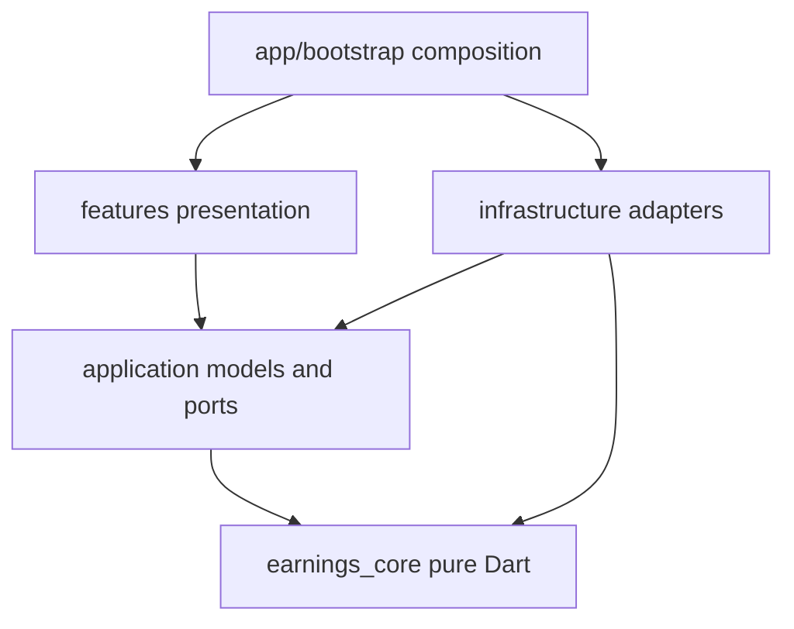
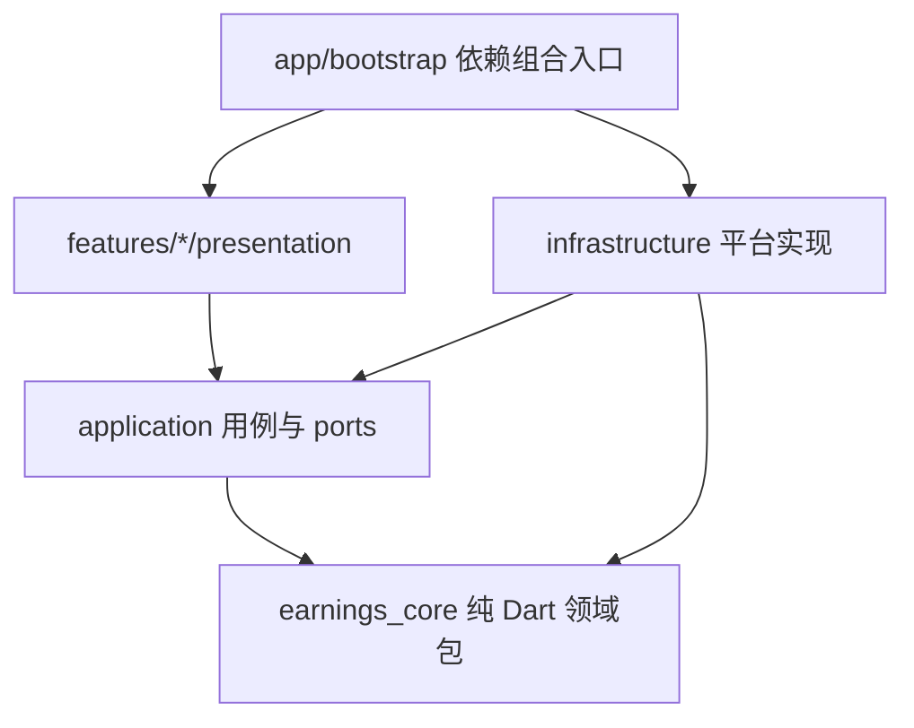

# Software architecture / 软件架构与工程目录

## English

Target baseline v0.1, 2026-11-09, with notes through 0.2.1. The target tree is a plan; it does not claim every proposed module exists.

### 1. Goals

Validate calculations/interaction on Web, then reuse core/UI for Android. Keep dependencies small, calculation offline, and avoid keepalive/sensitive permissions. No early microservices, queues, event bus or generic plugin framework. Separate docs/source/config/environment while preserving tool-required platform layouts.

### 2. Target layout

```text
PayBySecond/
  README.md
  .gitignore
  docs/
    requirements/product-spec.md
    architecture/software-architecture.md
    architecture/decisions/
    design/                         # calculation/storage/UI design
    testing/verification-plan.md
    development/environment.md
  src/
    apps/pay_by_second/             # single Flutter client root
      pubspec.yaml                  # dependencies/assets
      pubspec.lock                  # committed application lock
      analysis_options.yaml
      lib/
        main.dart                   # calls app/bootstrap.dart
        app/                        # composition, theme, routes, lifecycle
        application/
          ports/                    # proposed Clock/storage/auth ports
          models/                   # snapshots/load/error states
          use_cases/                # income/config/account orchestration
          services/                 # refresh/version/cache coordination
        features/
          dashboard/presentation/
          profile/presentation/
          calendar/presentation/
          auth/presentation/
          settings/presentation/
          overtime/presentation/
          updates/presentation/
        infrastructure/
          clock/
          storage/                  # native/Web adapters
          auth/                     # future HTTP/session adapters
          calendar/
          platform/                 # visibility/lifecycle bridges
        shared/presentation/
      assets/
        calendar/                   # validated/generated calendar
        config/                     # public settings only
        images/
      test/
      integration_test/
      web/
      android/
      windows/                      # future generated platform
      linux/                        # future generated platform
      macos/                        # future generated platform
    packages/earnings_core/
      pubspec.yaml
      lib/
        earnings_core.dart          # limited public exports
        src/                        # money/time/salary/schedule/calendar/engine
      test/fixtures/
  config/
    README.md
    app/                            # defaults/schemas/update source
    calendar/                       # sourced/versioned calendars
    quality/
    ci/
  env/
    examples/                       # only when actually consumed
    README.md
  tools/
    bootstrap/
    run/
    build/
    check/
  assets/branding/                  # optional design originals, not bundled
  .local/                           # ignored local settings/signing material
  out/                              # ignored packages/reports
```

There is one business implementation for Web/Android, with differences in infrastructure/platform projects. Web came first; Android source is present in 0.2.1. Desktop scaffolds remain deferred. Actual MVP application files are flatter than the proposed ports/use_cases hierarchy.

### 3. Dependency direction



| Module | Allowed | Prohibited |
|---|---|---|
| earnings_core | Standard library/reviewed pure-Dart precision or zone dependencies | Flutter, HTTP, filesystem/browser APIs, direct current-time reads |
| application | earnings_core, own ports/models; current UI-facing controllers use ChangeNotifier | Concrete platform/storage adapters, page widgets |
| infrastructure | Application ports, core, necessary plugins | Calling pages or deciding salary rules |
| presentation | Application, public domain values, Flutter | Direct storage/auth calls or duplicate money formulas |
| app/bootstrap | Public entry points of all layers | Business calculations |

No global ServiceLocator. Bootstrap creates/injects repositories, clocks and controllers. UI-facing controllers may use ValueNotifier/ChangeNotifier; the domain remains Flutter-independent. UI formats/orchestrates only. Separate package publishing is not an initial goal: the package establishes a testable dependency boundary.

### 4. Data/control flow

Target startup: public AppConfig → platform adapters → schema-versioned local settings → session recovery → calendar coverage → use cases/home. Onboard without settings; existing settings work offline. Real authentication remains deferred, with no simulated registration.

Queries capture one settings snapshot and one now, call core and return amount/rate/state/next boundary/coverage; only changed UI components update. Save validates, persists successfully, publishes settings, invalidates affected caches and recalculates. Failure retains input and cannot appear successful.

Future authentication: page → AuthUseCase → AuthGateway → HTTPS. Do not log passwords; backend failure must not block local estimates.

### 5. Intended interfaces

Design responsibilities, not existing exact signatures:

| Interface | Input/output | Location |
|---|---|---|
| EarningsEngine | Interval/now/policy versions/calendar → exact amount/rate | earnings_core |
| ScheduleCompiler | Schedule/overrides → merged, split, sorted intervals/prefix sums | earnings_core |
| Clock | Current instant/monotonic elapsed, injectable | application ports |
| ProfileRepository | Load/atomically save versioned settings, no tick writes | application ports |
| CalendarRepository | Region/year/source/revision snapshots | application ports |
| AuthGateway | Register/sign in/out/restore/revoke | application ports |
| VisibilitySource | Foreground/background/route/tab visibility | application ports |
| RefreshCoordinator | One refresh source and boundary scheduling | application services |

Expose permission/time-out failures explicitly and distinguish invalid data from system failures. Do not catch all salary errors and return a plausible zero.

### 6. Time/precision/ownership

Evaluate from time/rules, never refresh counts. Integer minor units/exact arithmetic/rounding belong to core. Fixed work zone defines boundaries; capture now once so cards agree across a second boundary. A session owns the visible refresh source; cancel it when covered/inactive. Controllers dispose listeners; bootstrap-created resources close with their session. Bound version-keyed caches, aggregate long history by year and never scan it every 100 ms. No background service, continuous requests or unbounded logs; consider workers after measured blocking only.

### 7. Configuration/platform conventions

Public configuration belongs in config/. Validate required fields, then generate approved assets/constants/build parameters; never copy whole env files. In 0.2.1, config/app/updates.json generates infrastructure/generated/update_config.dart through tools/build/update-config.ps1. Public metadata is not secret.

Keep pubspec/locks, Gradle/manifest and Web index in standard locations. Shared analysis rules live in config/quality and are included by application configuration, not duplicated. Future CI entry files stay at provider-required locations and call tools/ with config/ci parameters. Signing secrets are external, not public config.

### 8. Future backend

Do not create unused service scaffolds. Self-hosted auth would create src/services/account_api with its own dependencies/migrations/tests/operation docs; hosted auth should not create a redundant service. The server handles accounts/sessions/optional sync, never per-second ticks. No administrator credentials in clients. Sync defaults off and uses revisions/conflicts rather than device timestamps overwriting history.

### 9. Evolution

1. Web/core with fixed calculation cases.
2. Local setup/dashboard/storage/lifecycle.
3. Calendar/salary versions and real auth when selected; keep preview scope explicit.
4. Android adapters, permissions, signing and measured resources.
5. Desktop on supported hosts, sharing business tests.

Stages can overlap: test APKs preceded accounts/history. That does not complete deferred features.

### 10. Implementation boundaries

Executable rules are code/config/tests. Change requirements/calculation/boundary cases together and record material decisions as ADRs.

The MVP composes settings loading/saving in startup; DashboardState owns visibility and one Timer instead of a separate full UseCase/VisibilitySource/RefreshCoordinator hierarchy. Core/settings are independent; storage is injected. Add layers when accounts/versioned history justify them; do not claim the entire target exists.

Settings now use categories/onboarding and a language repository; see [navigation](../design/ui-navigation.md). Version 0.2.0 adds pure-Dart overtime snapshots, a separate ledger and cached closed totals; home reuses its timer and details refresh only while visible/active/foreground. See [overtime/input](../design/overtime-and-input.md).

Version 0.2.1 adds independent updater models/preferences/HTTP and a small Android MethodChannel for installed version/browser opening; it never accesses salary/overtime repositories. Native source now lives in android/. SDK paths, keys, build copies and APKs remain ignored. Real-device memory/energy/installation are not qualified.

## 中文

状态：设计基线草案 v0.1；2026-11-09。本文是目标结构，不表示树中的所有文件已经生成。

### 1. 架构目标

首先交付可体验的 Web 版本，验证工资计算和交互；随后复用计算核心和 UI 生成 Android APK。保持少依赖、离线可计算、无后台保活、无敏感权限。第一阶段不搭建微服务，不引入消息队列、事件总线或通用插件框架。

文档、业务源码、配置源、环境说明分别管理。Flutter 自身的平台工程和构建入口遵循工具链的标准布局，不为了顶层分类而搬动其约定文件。

### 2. 目标目录树

```text
PayBySecond/
  README.md
  .gitignore
  docs/
    requirements/
      product-spec.md
    architecture/
      software-architecture.md
      decisions/
        0001-web-first-flutter.md
    design/                         # 后续计算、存储、页面详细设计
    testing/
      verification-plan.md
    development/
      environment.md
  src/
    apps/
      pay_by_second/                # 唯一 Flutter 客户端工程根
        pubspec.yaml               # Flutter 依赖与资源入口
        pubspec.lock               # 应用锁文件提交
        analysis_options.yaml
        lib/
          main.dart                # 只调用 app/bootstrap.dart
          app/
            bootstrap.dart         # 组合依赖、读取配置、初始化
            app.dart               # MaterialApp、主题、路由
            lifecycle_controller.dart
          application/
            ports/                 # Clock、存储、认证等接口
            models/                # 应用快照、加载/错误状态
            use_cases/             # 查询收入、保存配置、账号用例
            services/              # 刷新协调、版本及缓存失效
          features/
            dashboard/presentation/
            profile/presentation/
            calendar/presentation/
            auth/presentation/
            settings/presentation/
          infrastructure/
            clock/
            storage/               # 原生文件/Web IndexedDB 适配
            auth/                  # HTTP、会话与凭证适配
            calendar/              # 日历包加载与验证
            platform/              # 可见性、生命周期等桥接
          shared/
            presentation/          # 通用数字组件、主题等
        assets/
          calendar/                # 从 config/calendar 校验后生成
          config/                  # 允许公开的运行配置
          images/                  # 实际随应用打包的资源
        test/                      # 应用用例、组件、适配器测试
        integration_test/          # 完整客户端流程
        web/                       # Web 平台工程
        android/                   # Android Gradle、Manifest 等
        windows/                   # 后续启用时生成
        linux/                     # 后续启用时生成
        macos/                     # 后续启用时生成
    packages/
      earnings_core/               # 不依赖 Flutter 的纯 Dart 包
        pubspec.yaml
        lib/
          earnings_core.dart       # 有限的公开导出接口
          src/
            money/
            time/
            salary/
            schedule/
            calendar/
            engine/
        test/
          fixtures/
  config/
    README.md
    app/                           # 默认值、配置 schema、公开环境配置
    calendar/                      # 有来源和版本的地区日历源
    quality/                       # 静态检查规则源和测试策略配置
    ci/                            # 构建矩阵、脚本参数与辅助配置
  env/
    examples/
      development.env.example
    README.md
  tools/
    bootstrap/
    run/
    build/
    check/
  assets/
    branding/                      # 设计原稿，不自动打包
  .local/                          # 忽略：本机配置、临时签名文件
  out/                             # 忽略：交付包、构建报告
```

没有分别建立 Web 和 Android 两套业务源码。两端共用同一个 Flutter 工程，只在 infrastructure 和平台工程中区分实现。先生成 Web；Android 在对应阶段启用，桌面工程暂不生成。

### 3. 依赖方向



| 模块 | 允许依赖 | 禁止事项 |
|---|---|---|
| earnings_core | Dart 标准库、经评估的纯 Dart 精度/时区依赖 | Flutter、HTTP、文件系统、浏览器 API、直接读取系统当前时间 |
| application | earnings_core、自有 ports 和应用模型 | 平台插件、具体 Repository 实现、页面组件 |
| infrastructure | application ports、earnings_core、必要的平台插件 | 调用页面、独自决定工资规则 |
| presentation | application、公开领域值类型、Flutter | 直接读写存储、发认证请求、复制工资公式 |
| app/bootstrap | 各层公开入口 | 承载业务计算规则 |

不引入全局 ServiceLocator。bootstrap 创建 Repository、Clock、UseCase 和页面控制器，通过构造函数注入。页面控制器可以使用 ValueNotifier/ChangeNotifier；application 和领域包不继承 Flutter UI 基类。

UI 只做格式化和操作编排。计算包独立发布不是首版目标；拆包的目的是形成可测试且无法意外依赖 Flutter 的边界。

### 4. 数据和控制流

启动：读取公开 AppConfig → 初始化平台适配器 → 读取带 schemaVersion 的本地配置 → 恢复会话 → 校验日历覆盖 → 创建用例和首页。无配置时进入引导；已有配置时可离线进入面板。真实登录必选与本机体验模式的产品决策仍按需求文档待确认。

查询：页面请求统计范围 → QueryEarnings 取得同一份配置快照和 now → earnings_core 计算 → 返回金额、速率、计薪状态、下一边界、日历完整性 → UI 只更新变化组件。

保存：验证输入 → 原子保存版本 → 仅成功后发布新配置快照 → 失效受影响缓存 → 重新计算。失败保留编辑内容，禁止提前显示为保存成功。

认证：登录页面调用 AuthUseCase → AuthGateway → HTTPS 服务。客户端不记录密码；认证不可用不阻断已有本地规则计算。未完成真实后端前只能显示本机模式，不能模拟注册成功。

### 5. 核心接口职责

以下是接口设计意图，不是已经存在的源码签名。

| 接口/服务 | 输入与输出 | 位置 |
|---|---|---|
| EarningsEngine | 时间区间、当前时刻、规则版本、日历快照 → 精确金额和当前速率 | earnings_core |
| ScheduleCompiler | 排班和日期例外 → 去重、分段、有序有效区间及前缀和 | earnings_core |
| Clock | 当前 instant、单调经过时间；可注入测试时钟 | application/ports |
| ProfileRepository | 加载/原子保存带版本配置；不每tick保存 | application/ports |
| CalendarRepository | 读取有地区、年份、来源和版本的日历快照 | application/ports |
| AuthGateway | 注册、登录、退出、恢复和撤销会话 | application/ports |
| VisibilitySource | 前台/后台、页面或标签可见性事件 | application/ports |
| RefreshCoordinator | 一个刷新源、可见性切换、下一工作边界调度 | application/services |

权限检查、网络超时等作为明确失败返回；数据校验失败与系统异常分开。不给工资规则加“万能 catch 后返回0”，以免错误变成看似正确的金额。

### 6. 时间、精度和资源所有权

- 金额始终根据当前时间和规则求值，不按刷新次数累加。1秒和100ms只影响显示频率。
- 输入金额存整数分；计算精度策略在 earnings_core 唯一实现，禁止 UI 和服务端各自舍入。
- 固定工作时区定义日历边界；所有查询只捕获一次 now，避免多个卡片跨秒读出不一致的快照。
- RefreshCoordinator 由应用会话持有，只有面板可见且应用活跃时开启一个刷新源；不可见即取消。
- 页面控制器拥有自己的监听器并释放；Repository 连接由 bootstrap 创建并在应用会话结束时关闭。
- 缓存有容量限制，键包含工资、排班和日历版本；历史跨年计算分批聚合，禁止每100ms扫描全部历史。
- 不引入后台服务、持续网络请求和无限日志。单线程起步，测得阻塞后才决定分批计算或工作线程。

### 7. 配置工程与平台约定

产品配置集中放在 config/；构建必须读取显式指定的配置，缺失关键项报错。生成脚本将经验证的公开字段写入应用 assets 或编译参数，不把原始 env 文件整体复制进应用。

Flutter 的 pubspec.yaml、lock 文件、Android Gradle/Manifest、Web index.html 等必须在标准工程位置保留。质量配置的共享规则可放 config/quality，应用根 analysis_options.yaml 仅引用它；不同时手工维护两份规则。

CI 平台要求的入口文件，例如未来的 .github/workflows 或 .gitlab-ci.yml，保留在工具要求位置，只调用 tools/ 脚本并引用 config/ci 参数。发布签名注入为环境秘密，不放 config/。

### 8. 未来后端边界

首阶段不生成空的服务端框架。选择自建认证时再创建 src/services/account_api，拥有自己的依赖清单、迁移、测试和运行说明；选择托管认证时不创建重复后端。

认证服务只负责账号、会话和可选配置同步，不承担每秒工资刷新。客户端内禁止嵌入服务端管理员密钥。同步默认不启用；启用后用配置 revision 检测冲突，不能靠设备时间简单覆盖历史。

### 9. 演进顺序

1. 初始化 Flutter Web 应用与纯 Dart 包，冻结计算测试样例。
2. 打通本地配置、主面板、保存与恢复、生命周期刷新。
3. 加入日历版本、薪资历史和真实账号；是否发布无账号早期体验版单独确认。
4. 启用 Android 工程，替换平台适配，验证权限、生命周期、内存和签名 APK。
5. 在对应宿主构建环境启用桌面平台，复用既有业务测试。

### 10. 实施约束

文档描述需求与设计；可执行规则来自代码、配置 schema 和测试。修改工资口径时同时修改需求、计算实现和边界用例，不另写一套散落的公式文档。每项重要决策以 ADR 记录原因、影响和替代方案。

当前已落地 Web 客户端、纯 Dart 计算包、测试、运行/构建脚本与 Web 平台工程。真实认证、官方日历包、历史版本和其余原生平台尚未实现，具体首版边界见 ADR-002。

目标架构与 MVP 的简化须区分：当前启动页承担配置读取/保存编排，DashboardState 持有可见性监听和单个刷新 Timer，尚未提取独立的配置 UseCase、VisibilitySource 或 RefreshCoordinator。工资算法与配置模型已独立，存储通过 Repository 注入；引入账号和历史版本时按本设计继续拆分，不把当前实现描述为所有目标模块均已完成。

UI已由单个profile配置弹窗调整为features/settings中的分类页面与首次分步流程，新增独立语言偏好Repository和Flutter内置本地化。当前页面职责以 [多页面与三语设计](../design/ui-navigation.md) 为准；领域计算层和薪资存储schema不变。

0.2.0新增纯Dart加班策略/时间区间、独立本地账本Repository与缓存统计控制器。首页复用原快照Timer，统计页仅在可见前台持有活动记录时刷新；具体源码边界及持久化策略见 [日期输入与加班设计](../design/overtime-and-input.md)。Android已在本机隔离工程生成测试签名APK，尚无真机资源数据，平台源码现已保留在src，构建副本与产物继续忽略。

0.2.1新增独立更新模型、偏好、HTTP适配及Android版本/浏览器MethodChannel，不访问薪资或加班Repository。当前应用侧控制器可使用ChangeNotifier，纯Dart领域层仍禁止依赖Flutter。
